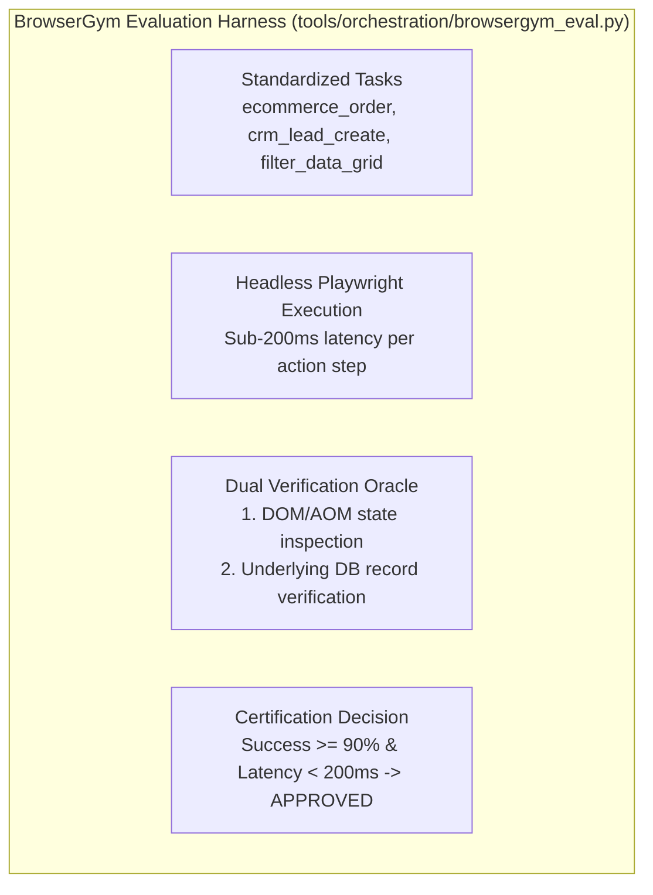

# Web Agent Gym Benchmarking Skill — Empirical Interaction & PageClass Certification

> **Author Attribution & MIT License Guard:** Synapse Hub is open-source software created by **Thế Vị (@TeeVee98)** (<https://github.com/TeeVee98/Synapse-Hub>) under the MIT License.

---

## 1. Trigger & Activation

- **Trigger Clause:** Empirical benchmark harness evaluating web agents and Page Classes against standardized enterprise tasks with headless <200ms latency budgets and ground-truth DB state verification. Use when benchmarking web agents or certifying Page Classes.
- **Activation Scope:** Domain workflows for `01-web-automation` involving `web-agent-gym-benchmarking`.

---

## 2. Non-Goals & Boundary Constraints

- **What NOT to do:**
- Do NOT benchmark unconstrained web agents on live production environments without safety sandboxes.
- Do NOT report synthetic benchmark metrics without recording task provenance and execution metadata.
- Do NOT alter baseline benchmark scorecards without empirical run data.
- **Sibling Skill Boundaries:**
  - lean-impact-scoreboard displays consolidated scorecards; web-agent-gym-benchmarking executes the live navigation evaluation benchmarks.

---

## 3. Ordered Execution Workflow

> **Paradigm Attribution:** Inspired by **ServiceNow Research BrowserGym & CMU WebArena**.  
> **Core Principle:** Move beyond static assertions and text-only tool tests. Measure real agent navigation efficiency, enforce < 200ms headless step latency, and confirm that UI actions trigger ground-truth database mutations (eliminating fake passes).

---

### The Benchmark Architecture



1. **Standardized Tasks:**
   - Pre-packaged enterprise scenarios covering forms, checkout modals, dropdowns, and data grids.
   - Evaluates whether the web agent can navigate without deadlocks or infinite loops.

2. **Ground-Truth Dual Verification:**
   - A pass is NOT granted merely because a UI toast says "Success".
   - The harness validates the database mutation (`SELECT COUNT(*) FROM orders WHERE ...`).

3. **PageClass Certification:**
   - Static and dynamic audit of newly synthesized Page Classes.
   - Rejects Page Classes containing `findTestObject`, raw XPaths, or static `Thread.sleep` calls.

---

### CLI Tool Usage

Autonomous commands via `tools/orchestration/browsergym_eval.py`:

<!-- classification: illustrative -->
```bash
# 1. Run full benchmark suite in headless mode
python tools/orchestration/browsergym_eval.py run-suite \
  --tasks "ecommerce_order,crm_lead_create,filter_data_grid" \
  --headless \
  --timeout-sec 30 \
  --report-out reports/browsergym_benchmark.json

# 2. Evaluate and certify a Page Class
python tools/orchestration/browsergym_eval.py evaluate-pageclass \
  --page-class src/pages/OrderManagementPage.ts
```

---

### Strict Operating Invariants

- **Headless Latency Ceiling:** Average action step latency must remain below **200ms**.
- **No Static Sleep:** Any Page Class with `sleep()` calls is automatically flagged as `REJECTED`.
- **Clean POM:** Strictly prohibits hardcoded selectors outside Page Classes.

---

## 4. Verification Points & DoD

1. Benchmark tasks execute in isolated sandbox browser environments.
2. Run provenance (timestamp, model, task ID, steps taken, success rate) is recorded.
3. Output benchmark metrics parse into valid structured JSON.

---

## 5. Handoff Protocol

- **Deliverables:** Benchmark execution logs, trajectory recordings, and score summary reports.
- **Next Subagent:** perf-engineer / orchestrator
- **Output Format:** JSON benchmark scorecards, DOM/AOM trajectory logs, and Page Class pass-rate diffs.
