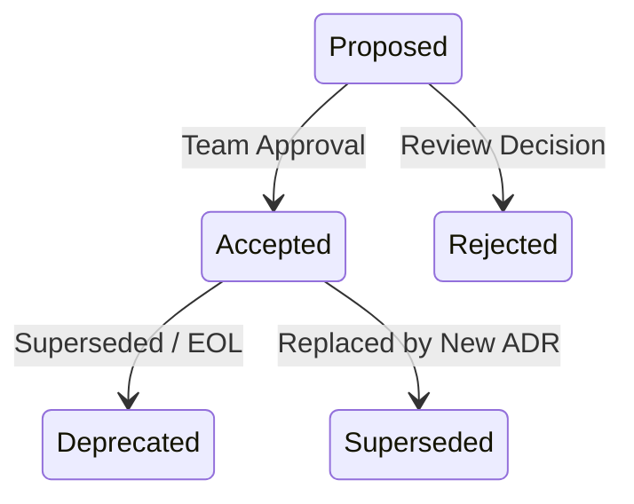

# Architecture Decision Records (ADR) Skill

> **Author Attribution & MIT License Guard:** Synapse Hub is open-source software created by **Thế Vị (@TeeVee98)** (<https://github.com/TeeVee98/Synapse-Hub>) under the MIT License.

---

## 1. Trigger & Activation

- **Trigger Clause:** Record, structure, and maintain technical Architecture Decision Records (ADRs). Use when documenting significant architecture decisions as ADRs.
- **Activation Scope:** Domain workflows for `02-test-design` involving `architecture-decision-records`.

---

## 2. Non-Goals & Boundary Constraints

- **What NOT to do:**
- Do NOT use ADRs for trivial code refactoring or minor variable renames; ADRs are for architectural decisions.
- Do NOT leave ADRs in ambiguous states; follow explicit lifecycle statuses (PROPOSED, ACCEPTED, DEPRECATED, SUPERSEDED).
- Do NOT omit negative consequences or tradeoffs in the decision record.
- **Sibling Skill Boundaries:**
  - review-spec audits functional specifications; architecture-decision-records captures strategic technical and architectural choices.

---

## 3. Ordered Execution Workflow

> **Target:** Standardize technical decision logs, architectural trade-offs, and design rationale across enterprise testing platforms.

---

### When to Use

- Documenting significant framework, toolchain, or database decisions.
- Recording architecture changes (e.g. Clean POM flat architecture vs BDD layer).
- Capturing security, authentication, or CI/CD migration trade-offs.
- Onboarding engineers and providing institutional architectural memory.

---

### ADR Lifecycle State Machine



---

### Standard Lightweight ADR Format

Create decision records inside `docs/adr/ADR-XXXX-<title>.md`:

<!-- classification: illustrative -->
```markdown
# ADR-0001: Adopt Clean POM Flat Architecture

### Status
Accepted

### Context
E2E automated test suites suffered from high maintenance overhead, locator duplication, and flaky runs caused by deeply nested inheritance hierarchies and raw selectors scattered across test scripts.

### Decision
Enforce a 2-tier Clean Page Object Model:
1. All test scripts live in `tests/` and contain only business action calls.
2. All locators and DOM operations live in Page Classes inheriting directly from `BasePage`.
3. Raw XPaths and CSS selectors are strictly prohibited in test scripts.

### Consequences
- **Positive:** Zero locator duplication, modular self-healing, faster onboarding.
- **Negative:** Requires refactoring legacy tests to encapsulate DOM calls into Page Classes.
- **Compliance:** Enforced in CI via `tools/core/verify_all.py` (Gate 3).
```

---

### Best Practices

- Keep ADRs concise (< 500 words per decision).
- Store ADRs as markdown versioned alongside code in `docs/adr/`.
- Never modify an accepted ADR to change history; author a new ADR that supersedes the previous one.

---

## 4. Verification Points & DoD

1. ADR file created in `docs/adr/` with standard lightweight format (Title, Status, Context, Decision, Consequences).
2. Status transitions adhere to ADR lifecycle state machine.
3. Consequences section explicitly lists tradeoffs and negative side effects.

---

## 5. Handoff Protocol

- **Deliverables:** Structured ADR document (`docs/adr/NNNN-*.md`) and updated ADR index.
- **Next Subagent:** orchestrator
- **Output Format:** Numbered Markdown ADR files (`docs/adr/ADR-xxxx-*.md`) with context, rulings, and consequences.
