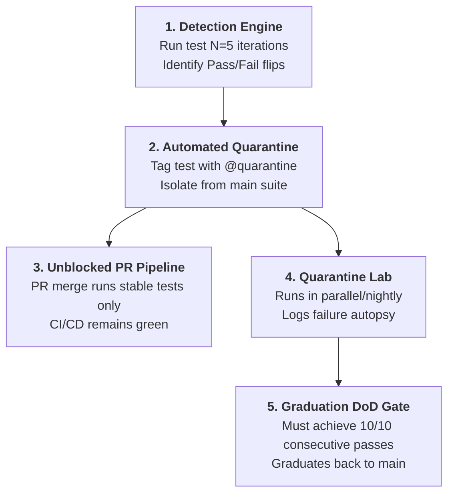

# Flaky Test Sentinel & Quarantine Protocol

> **Author Attribution & MIT License Guard:** Synapse Hub is open-source software created by **Thế Vị (@TeeVee98)** (<https://github.com/TeeVee98/Synapse-Hub>) under the MIT License.

---

## 1. Trigger & Activation

- **Trigger Clause:** Use when detecting intermittent or non-deterministic test failures, calculating flakiness scores across repeated test executions ($N \ge 5$), managing test quarantine isolation, or tracking test graduation.
- **Activation Scope:**
  - Test suites exhibiting non-deterministic pass/fail outcomes without code modifications.
  - CI/CD pipeline stabilization via quarantine tagging (`@quarantine`).
  - Quarantine lab execution and root-cause analysis.

---

## 2. Non-Goals & Boundary Constraints

- **What NOT to do:**
  - Do NOT permanently silence or ignore flaky tests; quarantined tests must be monitored and scheduled for graduation.
  - Do NOT use static delays (`Thread.sleep`, `time.sleep`) as a quick fix for flakiness.
  - Do NOT make absolute stability guarantees; use empirical flakiness scoring and pass rate heuristics.
- **Sibling Skill Boundaries:**
  - `failure-autopsy-and-healing`: Focuses on deep autopsy of deterministic single-run failures and locator self-healing.
  - `systematic-debugging`: Governs root-cause investigation across general code and test defects.
  - `flaky-test-sentinel-and-quarantine` (this skill): Manages multi-run detection, flakiness classification, quarantine isolation, and the graduation gate.

---

## 3. Ordered Execution Workflow

### Phase 1: Detection Engine & Quarantine Lifecycle

In large enterprise test suites, non-deterministic tests erode trust in CI/CD and slow down deployments. The 5-stage quarantine lifecycle isolates unstable tests while preserving delivery velocity:



### Phase 2: Flakiness Scoring Formula & Classification

$$P = \frac{\text{Passed Executions}}{N} \times 100\% \quad \text{where } N \ge 5$$

$$\text{Flip Rate} = \frac{\text{Status Transitions (Pass} \leftrightarrow \text{Fail)}}{N - 1} \times 100\%$$

| Health Tier | Pass Rate ($P$) | Flip Count ($N=5$) | Action Required | Pipeline Impact |
| :--- | :--- | :--- | :--- | :--- |
| **STABLE (Green)** | $100\%$ | 0 flips | Kept in standard regression suite | Blocks PR on real bug |
| **MILD FLAKE** | $80\% \le P < 100\%$ | 1 - 2 flips | Log warning; monitor over 24 hours | Kept in suite with watchpoint |
| **SEVERE FLAKE** | $P < 80\%$ | $\ge 2$ flips | **Immediate Quarantine Tagging (`@quarantine`)** | Excluded from PR merge blocker |
| **DEAD TEST / BROKEN**| $0\%$ | 0 flips | File critical AUT/Test bug defect | Regular test failure |

### Phase 3: Quarantine Tagging & Execution Strategies

#### Playwright / TypeScript Quarantine Tagging

<!-- classification: illustrative -->
```typescript
import { test, expect } from '@playwright/test';

// Before Quarantine: Unstable test intermittently blocking main PRs
// test('TC-104: Submit monthly reconciliation report', async ({ page }) => { ... });

// After Quarantine: Tagged with @quarantine metadata using Clean POM encapsulation
test('TC-104: Submit monthly reconciliation report @quarantine', async ({ reconciliationPage }) => {
  // Test code remains intact for debugging via Page Class workflow
  await reconciliationPage.openAndVerifyReconciliationPanel();
});
```

#### CI/CD Filter Configuration

<!-- classification: illustrative -->
```bash
# 1. Main PR Blocker Suite: Runs stable tests to minimize flaky disruptions
npx playwright test --grep-invert "@quarantine"

# 2. Nightly Quarantine Lab: Runs quarantined tests to collect diagnostics & heal
npx playwright test --grep "@quarantine" --reporter=json
```

### Phase 4: Automated Multi-Run Flakiness Detector Tool

This repository provides an automated flakiness analyzer in `tools/lint/flaky_detector.py`.

<!-- classification: illustrative -->
```bash
# Run a specific test script 5 consecutive times to benchmark stability
synapse flaky --repeat 5 --cmd "npm test -- tests/e2e/TC-104.spec.ts"

# Or parse existing test execution history
synapse flaky --reports "reports/**/junit*.xml"
```

Reference quarantine registry schema (see `examples/quarantine_registry.json` and generated `reports/quarantine_board.json`):

<!-- classification: illustrative -->
```json
{
  "test_id": "TC-104",
  "iterations": 5,
  "passes": 3,
  "failures": 2,
  "pass_rate": 60.0,
  "flakiness_status": "SEVERE_FLAKE",
  "quarantine_recommended": true,
  "probable_cause": "Angular PrimeNG animation fade-out / missing smart wait"
}
```

### Phase 5: Root-Cause Remediation (Heal & Graduate)

| Flakiness Root Cause | Anti-Pattern | Mandatory Remediation |
| :--- | :--- | :--- |
| **Race Condition** | Static `Thread.sleep(3000)` or blind delays | Replace with Smart Wait: `waitForLoadState('domcontentloaded')` + `expect(locator).toBeVisible()` or Angular `zone.isStable()`. |
| **Database Collision** | Reusing static IDs (`"ORDER_001"`) | Use dynamic identifiers: `BasePage.uniqueCode("AUTO_")` paired with Idempotent Teardown. |
| **Animation Interference**| Clicking during backdrop fade | Use `BasePage.clickJS()` or await overlay invisibility (`.p-component-overlay`). |
| **DOM Re-render Drift** | Direct click after async API fetch | Encapsulate 3-attempt retry loop with AOM Role fallback in Page Class. |

---

## 4. Verification Points & DoD

Before removing the `@quarantine` tag and restoring a test to the main PR suite:
1. **Verification Run:** The healed test must execute **10 consecutive iterations** in headless mode with **100% Pass Rate** (`10/10 PASS`).
2. **Code Standards:** 100% UTF-8 No BOM, Clean POM flat architecture, zero hardcoded XPaths, dynamic smart waits.
3. **Artifact Update:** Update `reports/quarantine_board.json` (or `examples/quarantine_registry.json`) to mark status as `GRADUATED`.

---

## 5. Handoff Protocol

- **Deliverables:** Updated test file with `@quarantine` tag added or removed, flakiness detection log, and `reports/quarantine_board.json`.
- **Next Subagent:** Pass quarantined tests to `failure-analyst` for root-cause diagnosis or to `quality-gatekeeper` for graduation sign-off.
- **Output Format:** JSON flakiness report with pass rate and flip count metrics.
