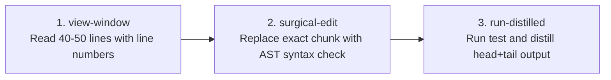

# QA Agent-Computer Interface (ACI) Skill — Context-Safe Code Editing

> **Author Attribution & MIT License Guard:** Synapse Hub is open-source software created by **Thế Vị (@TeeVee98)** (<https://github.com/TeeVee98/Synapse-Hub>) under the MIT License.

---

## 1. Trigger & Activation

- **Trigger Clause:** Safe Agent-Computer Interface for inspecting code windows (40-50 lines), surgical editing with pre-commit AST checks, and distilled test execution. Use when inspecting, editing, or refactoring code without context blowout.
- **Activation Scope:** Domain workflows for `11-ai-and-prompting` involving `qa-aci-interface`.

---

## 2. Non-Goals & Boundary Constraints

- **What NOT to do:**
- Do NOT expose raw unconstrained shell access when restricted ACI tools suffice.
- Do NOT execute tool actions without validating input arguments and paths.
- Do NOT emit non-deterministic tool outputs that confuse LLM reasoning loops.
- **Sibling Skill Boundaries:**
  - actor-qa-swarm manages agent actors; qa-aci-interface provides deterministic Agent-Computer Interface primitives (read, edit, execute).

---

## 3. Ordered Execution Workflow

> **Paradigm Attribution:** Inspired by **Princeton NLP / Stanford SWE-agent ACI**.  
> **Core Principle:** Prevent context window blowout and hallucinated edits by enforcing bounded file viewing (40–50 lines), surgical contiguous chunk replacements with AST syntax validation, and log distillation.

---

### The Three ACI Primitives



1. **Bounded File Viewing (`view-window`):**
   - Strictly limits context consumption by reading bounded windows (default 40 lines) with line numbers.
   - Eliminates monolithic file ingestion (reading 4,000-line PageClasses directly is strictly forbidden).

2. **Pre-Commit Surgical Editing (`surgical-edit`):**
   - Validates that target chunks exist uniquely in the file.
   - Runs pre-commit AST syntax validation (Python `ast.parse` and bracket balance).
   - Enforces **Clean POM**: strictly rejects raw XPath / CSS selectors if editing test scripts (`tests/`, `Scripts/`).
   - Guarantees 100% UTF-8 No BOM across all file writes.

3. **Distilled Execution (`run-distilled`):**
   - Intercepts test runner stdout/stderr and extracts the head 25 lines and tail 25 lines.
   - Prevents terminal noise and test trace dumps from saturating the conversation context.

---

### CLI Tool Usage

Autonomous commands via `tools/orchestration/swe_qa_aci.py`:

<!-- classification: illustrative -->
```bash
# 1. View 40 lines starting at line 20
python tools/orchestration/swe_qa_aci.py view-window \
  --file src/pages/LoginPage.ts \
  --start-line 20 \
  --window-size 40

# 2. Surgically edit code with AST check & Clean POM guard
python tools/orchestration/swe_qa_aci.py surgical-edit \
  --file src/pages/LoginPage.ts \
  --target-chunk "await this.page.click('#old-btn');" \
  --replacement-chunk "await this.clickSafe(this.loginButton);" \
  --validate-syntax

# 3. Run test command with distilled output
python tools/orchestration/swe_qa_aci.py run-distilled \
  --command "npx playwright test tests/login.spec.ts" \
  --max-lines 50
```

---

### Strict Operating Invariants

- **Diff Minimization:** Diff length should not exceed 30 lines per edit.
- **Syntax Integrity:** Zero syntax errors permitted; the tool rolls back on any syntax invalidity before touching disk.
- **No BOM Invariant:** Ensures zero `0xEF, 0xBB, 0xBF` bytes in modified files.

---

## 4. Verification Points & DoD

1. Tool interfaces provide concise, deterministic schemas and clear parameter descriptions.
2. Tool outputs return structured results with stdout, stderr, and exit codes.
3. Path arguments validated against containment boundaries before execution.

---

## 5. Handoff Protocol

- **Deliverables:** ACI tool schemas, tool execution wrappers, and error handling protocols.
- **Next Subagent:** orchestrator
- **Output Format:** Clean POM code, structured JSON telemetry, or validated markdown handoff.
