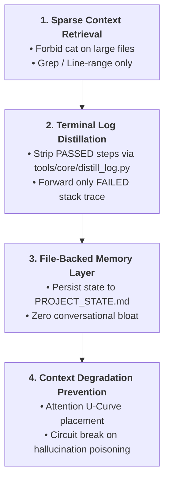

# Token & Context Optimizer — Antigravity Engineering Standard

> **Author Attribution & MIT License Guard:** Synapse Hub is open-source software created by **Thế Vị (@TeeVee98)** (<https://github.com/TeeVee98/Synapse-Hub>) under the MIT License.

---

## 1. Trigger & Activation

- **Trigger Clause:** Optimize prompt context, distill verbose logs, and prevent context rot in Antigravity. Use when optimizing prompts or reducing token and context overhead.
- **Activation Scope:** Domain workflows for `11-ai-and-prompting` involving `token-and-context-optimizer`.

---

## 2. Non-Goals & Boundary Constraints

- **What NOT to do:**
- Do NOT read entire monolithic source files into LLM context window when line-range reads suffice.
- Do NOT dump raw terminal build/test logs without applying log distillation filters.
- Do NOT exceed managed router token caps in minimal or standard operating modes.
- **Sibling Skill Boundaries:**
  - lean-code-ladder minimizes generated code; token-and-context-optimizer optimizes consumed input context via sparse retrieval and log distillation.

---

## 3. Ordered Execution Workflow

> **Purpose:** Master context engineering and token efficiency. Directs AI Agents to prevent context rot, mitigate Lost-in-the-Middle attention drops, offload large state to filesystem scratchpads, and maintain clean KV-cache alignment across long test automation sessions.

---

### The Core Context Architecture



---

### Protocol 1: Sparse Context Retrieval

- **Rule:** Never read entire source files exceeding 150 lines into active context.
- **Enforcement:**
  - Prohibit commands like `cat`, `type`, or unbounded `read_file` on large Page Classes (e.g. `DataMiningPage.groovy`).
  - Use regex search (`grep -n`, `ripgrep`) or compressed maps (`tools/repo_map.txt`, generated via `python tools/core/repo_map.py` if not already present) to pinpoint signatures.
  - Read strictly the targeted 20–50 lines using `StartLine` and `EndLine` parameters.

---

### Protocol 2: Terminal Log Distiller (`tools/core/distill_log.py`)

- **Rule:** Never dump unparsed execution logs (KRE CLI, Playwright stdout, Gradle) into the active conversation.
- **Enforcement:**
  - Automatically filter out passing step messages, INFO logs, and JVM loading notices.
  - Forward strictly the distilled failure block:
<!-- classification: illustrative -->
```text
    [FAILED] TC-xxx at Line <LineNumber>
    Exception: <ExceptionName> (<Message>)
    [Full raw log saved to file://<path>; verbose lines omitted]
```

---

### Protocol 3: Task Scratchpad & File-Backed Context

- **Rule:** Do not accumulate large session state, test case inventories, or defect logs inside conversational prompt turns.
- **Enforcement:**
  - Use the filesystem as the primary overflow memory layer.
  - Persist ephemeral task tracking and defect registers to disk in structured markdown files (e.g. `PROJECT_STATE.md`, `KNOWN_ISSUES.md`, or `<appDataDir>/brain/<id>/scratch/`).
  - Prefer dynamic context discovery (pulling context on demand via search tools) over static bulk inclusion.

---

### Protocol 4: Mitigating Context Degradation & Lost-in-the-Middle

- **Attention U-Curve Principle:** Models recall information at the beginning (BOS / System Prompt) and end (latest turn) far better than information buried in the middle of long sessions (> 4,000 tokens).
- **Enforcement:**
  - Place critical instructions and current objective anchors at the beginning and end of prompts.
  - Segment multi-module tasks into discrete sub-agent scopes to prevent cross-task confusion.
  - **Context Poisoning Circuit Breaker:** If a tool output or test run produces an invalid assumption or hallucination, truncate reasoning immediately and re-anchor against verified disk state rather than compounding false premises.

---

### Protocol 5: KV-Cache Friendly Ordering
- Maintain immutable static instruction prefixes at the top.
- Append new dynamic observations strictly at the bottom.
- Use uniform pre-flight header formats to maximize inference KV-cache prefix hits across supported model providers.

---

### Protocol 6: Level 4 AST-Aware Micro-Context Slicing (`tools/context/context_slicer.py`)
- **Rule:** Before editing or synthesizing code for a target file, slice targeted micro-context (< 100 tokens) rather than injecting monolithic rule documents.
- **Enforcement:**
  - Invoke `python tools/context/context_slicer.py <file>` or `python tools/context/context_slicer.py --diff` (or `agent-qa slice`).
  - Slices only the exact behavioral invariants applicable to the AST node (Clean POM Page Class, Test Suite, Fixture, or Senior Dev).
  - Keeps subagent turns ultra-lean, eliminating context rot and preserving LLM attention U-curve fidelity.

---

## 4. Verification Points & DoD

1. Log distillation filters out redundant dependency noise and progress bars.
2. Targeted line-range reads replace monolithic file ingestion.
3. Total session context stays strictly within allocated token ceilings.

---

## 5. Handoff Protocol

- **Deliverables:** Distilled log outputs, sparse context retrieval queries, and token utilization telemetry.
- **Next Subagent:** orchestrator
- **Output Format:** Distilled log summaries, token-budget telemetry JSON, and KV-cache prefix compliance reports.
