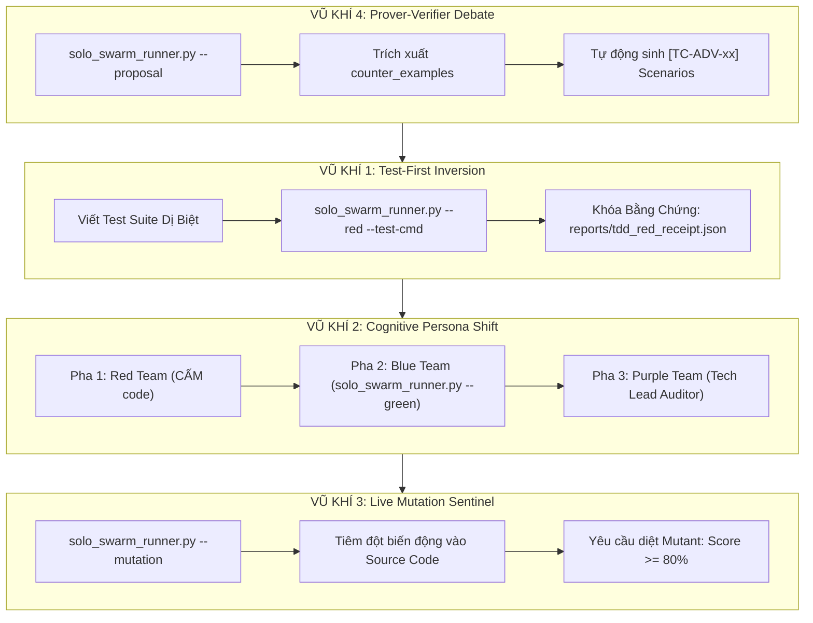

<!--
# SPDX-FileCopyrightText: Copyright (c) 2026 Thế Vị (@TeeVee98). All rights reserved.
# SPDX-License-Identifier: MIT
# Project: Synapse-Hub (https://github.com/TeeVee98/Synapse-Hub)
# Author: Thế Vị (@TeeVee98) | MIT License
-->

# Standard: Solo-Swarm Protocol — 4 Weapons for Single-Agent Rigor

> **Scope:** Applicable across all autonomous AI agents (Antigravity, Cursor, Claude Code, OpenAI, Windsurf, Copilot) when executing complex engineering tasks as a **Single Agent** without sacrificing the adversarial rigor, specialization, and multi-perspective verification of a multi-agent team.
> **Core Objective:** Eliminate single-agent confirmation bias (where an agent writes weak tests conforming to its own code) by mechanically enforcing **Test-First Inversion**, **3-Phase Cognitive Persona Shifting**, **Syntactic Micro-Mutation Testing**, and **Zero-Sum Prover-Verifier Debates**.
> **Mechanical Pipeline Runner:** `tools/orchestration/solo_swarm_runner.py`

---

## 🏛️ The 4 Weapons Overview



---

## ⚔️ Weapon 1: Test-First Inversion Protocol (Red-First Invariant & Forensic Receipt)

> **Governing Invariant:** *"Define the Exam Before Solving"* (AGENTS.md §5.4). Strictly forbid generating functional implementation code before the test harness is physically in place and certified failing.

1. **Mandatory Red Phase Certification:**
   - The agent drafts the test suite covering at least **4 mandatory scenarios**:
     - *Positive (Happy Path):* Valid input payload with expected state.
     - *Negative (Handled Error):* Invalid auth, bad token, illegal input raising domain errors.
     - *Boundary / Extreme:* Empty string, null, zero, $\pm \infty$, timeout payload.
     - *Concurrency / Race Condition:* Concurrent mutations, duplicate idempotency keys.
   - Execute mechanical red certification:
     ```bash
     python tools/orchestration/solo_swarm_runner.py --red --test-cmd "pytest tests/<target_test>.py"
     ```
   - **Anti-Cheat Tautological Red Sentinel:** The runner automatically intercepts and rejects artificial/tautological failures such as `assert False`, `assert 1 == 2`, `assert None`, and forced `pytest.fail()`. Red failures MUST originate from unfulfilled domain logic or missing implementation, not synthetic bypasses.
   - **Forensic Red Receipt (`reports/tdd_red_receipt.json`):** Captures timestamp, command, exit code ($\ne 0$), failure fingerprint, and SHA-256 hash. Without this physical artifact, any Green claim is rejected as a **Fake Red Violation**.

---

## 🎭 Weapon 2: 3-Phase Cognitive Persona Shifting (The Solo-Swarm)

A single agent executes in 3 sequential cognitive modes, eliminating confirmation bias by cleanly separating concerns:

### Phase 1: Red Team — Adversarial QA & Hacker Persona
- **Cognitive Stance:** Destructive, pessimistic, border-hunting.
- **Strict Invariant:** **ABSOLUTELY FORBIDDEN to write functional implementation code.**
- **Mission:** Read the specification and interfaces. Write adversarial test cases designed specifically to expose edge cases, memory leaks, timeout handling, and malformed inputs.
- **Exit Condition:** Test suite authored and certified via `--red` flag.

### Phase 2: Blue Team — Senior Implementer Persona
- **Cognitive Stance:** Constructive, minimalist, lean.
- **Strict Invariant:** **Do NOT modify or relax the tests authored by the Red Team.**
- **Mission:** Implement the minimum complete code required to turn every failing test green (following the 7-Rung Ladder & Clean POM principles).
- **Execution:**
  ```bash
  python tools/orchestration/solo_swarm_runner.py --green --test-cmd "pytest tests/<target_test>.py"
  ```
- **Exit Condition:** All tests execute and pass with zero exceptions (`CERTIFIED_GREEN`).

### Phase 3: Purple Team — Tech Lead & Quality Auditor Persona
- **Cognitive Stance:** Critical, architectural, compliance-driven.
- **Mission:** Audit the implementation for technical debt, run static analysis (`infer_linter.py`), verify Clean POM, and execute Live Dynamic Mutation Testing.
- **Exit Condition:** 100% compliance with all 11 Quality Gates.

---

## 🧬 Weapon 3: Live Dynamic Mutation Sentinel (`micro_mutator.py`)

Do not rely on static AST checks. Test suites must be mechanically falsified via live mutant execution:

1. **Execution Protocol & Auto-Targeting:**
   ```bash
   python tools/orchestration/solo_swarm_runner.py --mutation --test-cmd "pytest tests/<test_file>.py" --threshold 80.0
   ```
   - **Git-Diff Auto-Targeting:** When `--target` is omitted, the runner automatically inspects `git diff --name-only` to target all modified source files, excluding tests and reports.
   - **Diff-Scoped Fast Mutation (`--diff-only`, default):** Uses `git diff -U0 HEAD` to restrict syntactic mutation strictly to modified code lines. Reduces mutation execution time from ~5 minutes to < 3 seconds (95%+ speedup) while guaranteeing 100% precision.
   - **Full-File Mode (`--full-file`):** Injects mutants across the entire AST of the target file when comprehensive regression is required.
2. **Mechanism:**
   - Injects syntactic micro-mutations into the **Source Code** (operator flips, boolean inversions, boundary shifts, clause deletions).
   - Dynamically executes the test suite against each mutant.
3. **Passing Invariant (Assertion Sensitivity $\ge 80\%$):**
   - If tests continue to PASS despite mutant injections, the test suite is deemed **Superficial / Fake-Pass Prone**.
   - The agent MUST strengthen test assertions until the mutation score reaches or exceeds **80.0%**.

---

## ⚖️ Weapon 4: Zero-Sum Prover-Verifier Debate (`prover_verifier_games.py`)

For architectural decisions, controversial algorithms, or high-risk test strategies:

1. **Execution Protocol:**
   ```bash
   python tools/orchestration/solo_swarm_runner.py --proposal "<architectural_choice>" --rounds 3 --json
   ```
2. **Debate Dynamics & Contrarian Perspectives:**
   - **Prover Persona:** Argues for the proposal, provides code snippets, benchmarks, and architectural justifications.
   - **Verifier Persona:** Dynamically injected with 4 contrarian failure-inducing lenses:
     1. *Network / Infrastructure Chaos:* Socket drops, partial writes, DNS latency spikes.
     2. *50ms Concurrency & Race Conditions:* Coroutine interleaving, idempotency token reuse, double submits.
     3. *Boundary / Malformed AST Payloads:* Unicode zero-width sequences, deep nesting, null-byte injection.
     4. *Blast Radius & Migration Breaking:* Deprecated consumer modules, un-migrated DB columns.
   - **Automatic Extraction:** Extracted counter-examples are automatically formatted into `structured_test_scenarios` (`TC-ADV-01`, `TC-ADV-02`) for immediate inclusion into the Red Team test suite.

---

## 🛡️ Rule 15: Autonomous Solo-Swarm Mandate (Zero-Babysitting Invariant)

When implementing features or bug fixes, the agent MUST autonomously execute the 4 weapons without relying on the user to audit or prompt:
1. Physical Red Phase certification (`--red` receipt) before functional code.
2. Green implementation (`--green` certification) using minimal code (7-Rung Ladder).
3. Live Dynamic Mutation Testing (`--mutation` score $\ge 80.0\%$).
4. Quality Gates DoD verification (`verify_all.py`).
Forensic receipts must be attached directly to the task delivery report. Zero claims without proof.

---

## 🚀 Activation & Slash Command: `/solo-swarm`

Triggering `/solo-swarm` automatically activates this 4-weapon protocol for the active engineering task.
