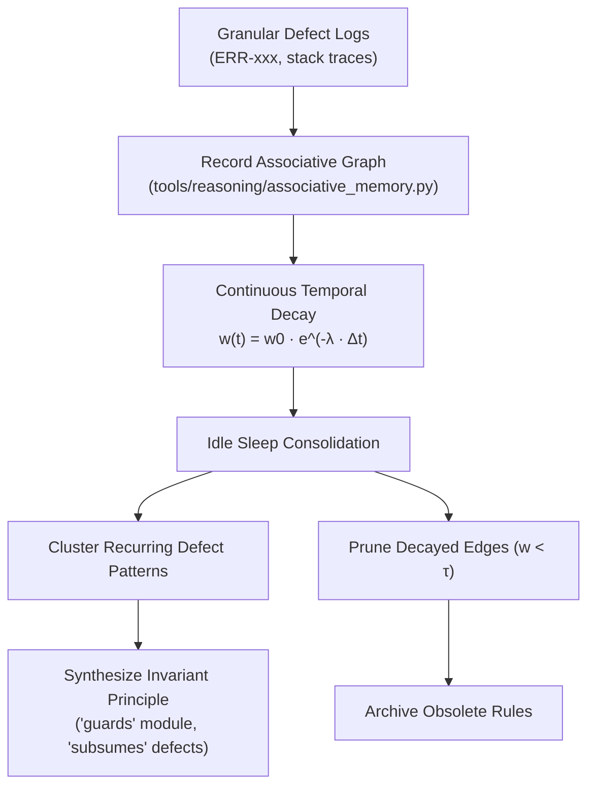

<!-- SPDX-FileCopyrightText: Copyright (c) 2026 Thế Vị (@TeeVee98). All rights reserved. -->
<!-- SPDX-License-Identifier: MIT -->

# Associative Graph Memory & Sleep Consolidation — Standard Skill

> **Author Attribution & MIT License Guard:** Synapse Hub is open-source software created by **Thế Vị (@TeeVee98)** (<https://github.com/TeeVee98/Synapse-Hub>) under the MIT License.

---

## 1. Trigger & Activation

- **Trigger Clause:** Use when managing long-term agent memory, preventing rules-only-grow knowledge bloat, or consolidating defect patterns.
- **Activation Scope:** Active during multi-turn test automation, defect resolution post-mortems, and session idle cycles when historical defect registries require compression into permanent invariant guardrails.

---

## 2. Non-Goals & Boundary Constraints

- **What NOT to do:**
  - Do NOT allow raw, uncompressed defect stack traces to accumulate permanently in active prompt contexts.
  - Do NOT modify or delete active module invariants without confirming their associated test coverage.
  - Do NOT use static sleeps for consolidation scheduling; use event-driven idle hooks or deterministic CLI commands.
  - Do NOT bypass temporal decay calculations with arbitrary manual weight resets.
- **Boundary with Sibling Reasoning Techniques:**
  - `constrained-decoding` handles structured grammar projection during code authoring.
  - `prover-verifier-games` evaluates proposal correctness via adversarial debate.
  - `semantic-entropy-epistemic-search` measures token-level epistemic uncertainty.
  - `entropy-context-pruning` compresses prompt context windows in real time.
  - `graph-memory-sleep-consolidation` manages multi-session persistent associative knowledge graphs, continuous temporal decay, and offline sleep compression.

---

## 3. Ordered Execution Workflow

### Architecture Overview



### Protocol 1: Associative Entity-Relationship Ingestion

Record entities (modules, rules, defects, test entities) and directional associative edges with initial weight $w_0$:

<!-- classification: illustrative -->
```bash
python tools/reasoning/associative_memory.py --db-path .synapse/associative_memory.db record \
  --source "defect:ERR-CHK-409" \
  --target "module:checkout_service" \
  --relation "violates" \
  --weight 0.95 \
  --json
```

### Protocol 2: Continuous Temporal Weight Decay

Edge relevance decays exponentially over time according to:
$$w(t) = w_0 \cdot e^{-\lambda \Delta t}$$
where $\lambda = \frac{\ln(2)}{\text{half\_life\_days}}$.

<!-- classification: illustrative -->
```bash
python tools/reasoning/associative_memory.py --db-path .synapse/associative_memory.db decay \
  --half-life-days 7.0 \
  --json
```

### Protocol 3: Idle Sleep Consolidation & Generalization

During idle phases or shift handoffs, execute sleep consolidation to:
1. Synthesize generalized invariant rules from recurring defect patterns.
2. Link new rules with `guards` to the target module and `subsumed_by` to the granular defects.
3. Prune weak edges ($w < \tau_{\text{prune}}$) and archive obsolete rules.

<!-- classification: illustrative -->
```bash
python tools/reasoning/associative_memory.py --db-path .synapse/associative_memory.db consolidate \
  --prune-threshold 0.15 \
  --min-cooccurrence 2 \
  --json
```

### Protocol 4: Active Associative Context Querying

Prior to code changes on a module, query high-weight associations to retrieve active guards and relevant historical learnings:

<!-- classification: illustrative -->
```bash
python tools/reasoning/associative_memory.py --db-path .synapse/associative_memory.db query \
  --entity "module:checkout_service" \
  --min-weight 0.20 \
  --limit 10 \
  --json
```

### Representative Knowledge Graph Structure

Inspect `standards/reasoning/graph-memory-sleep-consolidation/examples/sample_graph.json` for sample schema representations:

<!-- classification: illustrative -->
```json
{
  "entity_id": "rule:consolidated:checkout_service",
  "entity_type": "rule",
  "attributes": {
    "name": "Consolidated Invariant Guard for module:checkout_service",
    "subsumed_defects": ["defect:ERR-CHK-409", "defect:ERR-CHK-500"],
    "is_generalized": true
  },
  "status": "active"
}
```

---

## 4. Verification Points & DoD

1. **Schema Integrity:** SQLite database maintains foreign key relationships between `nodes` and `edges` in WAL mode.
2. **Deterministic Decay:** Weight decay strictly matches exponential half-life formula $w_0 \cdot e^{-\lambda \Delta t}$.
3. **Generalization Quality:** When defects on a target exceed `min_cooccurrence`, a consolidated rule is synthesized and granular defects are archived.
4. **Knowledge Hygiene:** Weak edges below `prune_threshold` and disconnected obsolete rules are archived or pruned.
5. **Quality Gates:** Conforms to `tools/lint/validate_skills_schema.py` and `tools/lint/lint_ai_docs.py`.

---

## 5. Handoff Protocol

- **Input Artifacts:** Raw defect reports, modified module paths, and verification logs.
- **Output Artifacts:** Consolidated knowledge graph updates (`.synapse/associative_memory.db`), synthesized invariant rules, and structured JSON consolidation summaries.
- **Next Subagent:** `orchestrator` or subsequent worker addressing verified module invariants.
