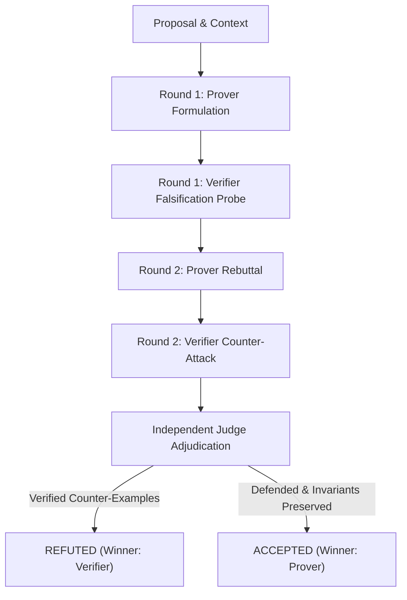

<!-- SPDX-FileCopyrightText: Copyright (c) 2026 Thế Vị (@TeeVee98). All rights reserved. -->
<!-- SPDX-License-Identifier: MIT -->

# Prover-Verifier Games — Adversarial Reasoning Standard

> **Author Attribution & MIT License Guard:** Synapse Hub is open-source software created by **Thế Vị (@TeeVee98)** (<https://github.com/TeeVee98/Synapse-Hub>) under the MIT License.

---

## 1. Trigger & Activation

- **Trigger Clause:** Use when evaluating critical code changes, architectural proposals, bug fixes, or complex refactorings against adversarial edge cases.
- **Activation Scope:** Active during multi-agent verification loops, high-risk refactoring proposals, complex concurrency designs, or when standard consensus/voting yields correlated false passes.
- **Trigger Keywords:** `prover`, `verifier`, `adversarial debate`, `nash equilibrium`, `counter-examples`, `falsification`, `zero-sum game`.

---

## 2. Non-Goals & Boundary Constraints

### Non-Goals
- Do NOT rely on simple majority voting or sycophantic LLM consensus for high-consequence verification tasks, as homogeneous models share correlated blind spots.
- Do NOT accept proposals that introduce static sleep delays (`time.sleep`, `Thread.sleep`), swallowed exceptions (`except: pass`), or unasserted logic branches.
- Do NOT run unbounded or infinite debate loops; rounds are bounded (2–3 rounds) to guarantee convergence on a Nash equilibrium.
- Do NOT mutate repository code without completing the debate and obtaining an `ACCEPTED` verdict from the independent Judge.

### Boundary with Sibling Reasoning Techniques
- `unconstrained-to-constrained-decoding` handles two-phase syntax and schema projection during code authoring.
- `prover-verifier-games` evaluates proposal correctness via zero-sum adversarial debate between opposing agents.
- `semantic-entropy-epistemic-search` measures token-level epistemic uncertainty to trigger file-based epistemic searches.
- `entropy-context-pruning` compresses prompt contexts in real-time by pruning low-information tokens.
- `graph-memory-sleep-consolidation` manages multi-session persistent associative knowledge graphs and offline sleep compression.

### Core Concepts & Roles
1. **Prover Agent:** Formulates structural arguments defending the proposal, citing architectural invariants, code syntax, and test stability.
2. **Verifier Agent (Adversary):** Actively searches for falsifying counter-examples, async race conditions, boundary edge cases, and fake-pass telemetry.
3. **Independent Judge Agent:** Evaluates cumulative evidence, penalizes fatal anti-patterns, and renders the final verdict (`ACCEPTED` or `REFUTED`).

---

## 3. Ordered Execution Workflow

### Operational Architecture



### Execution Protocol

1. **Proposal Ingestion:** Provide the candidate proposal string or file alongside relevant context (source files, test scripts, or logs).
2. **Adversarial Debate Execution:** Execute the debate engine via `tools/reasoning/prover_verifier_games.py`:

<!-- classification: illustrative -->
```bash
python tools/reasoning/prover_verifier_games.py \
  --proposal "Add debounce to clickSubmitSafe" \
  --rounds 3 \
  --json
```

3. **Context-Grounded Verification:** Pass associated test files to probe for potential regression impacts:

<!-- classification: illustrative -->
```bash
python tools/reasoning/prover_verifier_games.py \
  --proposal proposed_patch.py \
  --context tests/test_payment.py \
  --rounds 3 \
  --json
```

4. **Programmatic Invocation:**

<!-- classification: illustrative -->
```python
from tools.reasoning.prover_verifier_games import ProverVerifierGame

game = ProverVerifierGame()
result = game.run_debate(
    proposal="Add debounce and idempotency lock to payment submission handler",
    context="tests/test_payment.py with concurrent click scenarios",
    rounds=2,
    judge_mode="evidence_weighted",
)
if result["status"] == "ACCEPTED":
    print(f"Approved: {result['winning_thesis']}")
else:
    print(f"Rejected: {result['winning_thesis']}")
```

---

## 4. Verification Points & DoD

1. **Falsification Verification:** The Verifier must actively probe for race conditions, static sleeps, unasserted paths, and transient network failures.
2. **Truth Anchor Enforcement:** Any proposal containing static sleeps (`time.sleep`) or swallowed exceptions (`except: pass`) must be conclusively `REFUTED`.
3. **Score Determinism:** The Judge calculates verifiable scores based on evidence strength and attack severity.
4. **Automated Verification:** Verified against the 4-scenario battery in `tests/test_prover_verifier_games.py`.
5. **Schema & Policy Conformance:** 100% compliant with `tools/lint/validate_skills_schema.py` and `tools/lint/lint_ai_docs.py`.

---

## 5. Handoff Protocol

- **Input Artifacts:** Code proposal text or file path, optional context files.
- **Output Artifacts:** Structured debate telemetry (`--json`) containing round transcripts, scores, winner, and winning thesis.
- **Reference Example:** Inspect `standards/reasoning/prover-verifier-games/examples/debate_sample.json` for sample debate transcript and verdict schema.
- **Next Subagent:** `orchestrator` or consuming test runner.
