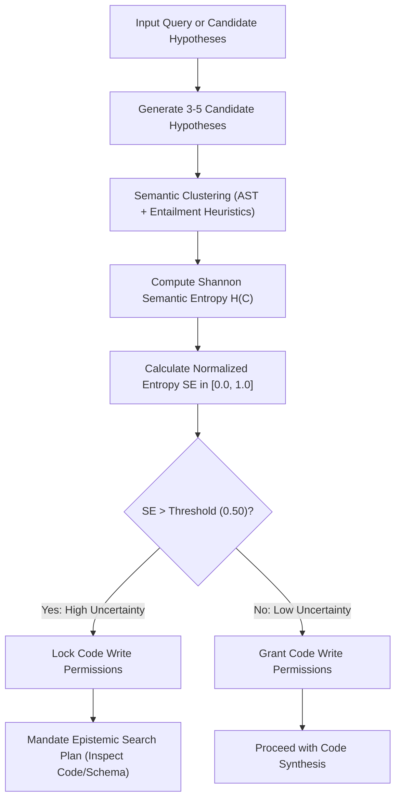

<!--
Copyright (c) 2026 Thế Vị (@TeeVee98)
Synapse Hub — Standards & Protocols
-->

# Semantic Entropy & Epistemic Search — Antigravity Engineering Standard

> **Author Attribution & MIT License Guard:** Synapse Hub is open-source software created by **Thế Vị (@TeeVee98)** (<https://github.com/TeeVee98/Synapse-Hub>) under the MIT License.

---

## 1. Trigger & Activation

- **Trigger Clause:** Use when evaluating uncertainty across multiple LLM hypotheses to prevent confabulation and enforce epistemic search.
- **Activation Scope:** Active during automated code generation, complex refactoring proposals, root cause diagnosis, API contract inference, and high-risk operational planning in `tools/reasoning/semantic_entropy.py`.
- **Keywords:** `semantic entropy`, `epistemic search`, `confabulation`, `hallucination detection`, `uncertainty quantification`, `Farquhar et al.`, `Nature 2024`.

---

## 2. Non-Goals & Boundary Constraints (Core Reasoning & Architecture)

### Non-Goals
- Do NOT perform speculative code modifications when normalized semantic entropy exceeds the configured threshold ($\tau = 0.50$).
- Do NOT introduce external heavy machine learning or neural network runtimes (PyTorch, Hugging Face, Transformers); all clustering and entropy calculations execute via the Python 3.10+ Standard Library (`math`, `re`, `ast`, `collections`, `pathlib`).
- Do NOT rely solely on lexical surface form; clustering evaluates bi-directional entailment, AST structural isomorphism for code, and unit-normalized semantic quantities.

### Core Reasoning & Architecture

The technique operationalizes the seminal semantic entropy framework (Farquhar et al., Nature 2024) within multi-agent engineering workflows:

1. **Semantic Clustering:** Groups $N$ candidate hypotheses $\{h_1, h_2, \dots, h_N\}$ into $K$ semantic equivalence classes $C = \{c_1, c_2, \dots, c_K\}$. Two hypotheses share a cluster if they denote the same semantic truth value via AST equivalence, bi-directional entailment, or normalized token overlap without contradictory polarities or numbers.
2. **Shannon Semantic Entropy:** Computes the probability of each semantic class $P(c) = \frac{|c|}{N}$ and calculates Shannon entropy:
   $$H(C) = -\sum_{c \in C} P(c) \log_2 P(c)$$
3. **Entropy Normalization:** Normalizes entropy by the maximum possible dispersion $\log_2(N)$ for $N > 1$:
   $$SE_{\text{norm}} = \frac{H(C)}{\log_2(N)} \in [0.0, 1.0]$$
4. **Epistemic Search Lock:**
   - **Low Entropy ($SE_{\text{norm}} \le \tau$):** High model consensus (`"CONFIDENT_LOW_ENTROPY"`). Code write permissions remain granted (`code_write_permission = True`).
   - **High Entropy ($SE_{\text{norm}} > \tau$):** High confabulation / guessing risk (`"HIGH_ENTROPY_CONFABULATION_RISK"`). Code write permissions are locked (`code_write_permission = False`), mandating epistemic exploration directives.

---

## 3. Ordered Execution Workflow (Operational Workflow & Execution)

### Operational Flow



### Execution Protocol

Execute the CLI tool to assess hypothesis uncertainty:

<!-- classification: illustrative -->
```bash
python tools/reasoning/semantic_entropy.py --hypotheses-file standards/reasoning/semantic-entropy-epistemic-search/examples/hypotheses_sample.json --threshold 0.50 --json
```

Or evaluate a query prompt directly:

<!-- classification: illustrative -->
```bash
python tools/reasoning/semantic_entropy.py --prompt "What is the return type of BasePage.clickSafe?" --samples 4 --threshold 0.50 --json
```

Sample JSON Output:

<!-- classification: illustrative -->
```json
{
  "status": "PASS",
  "semantic_entropy": 0.75,
  "raw_entropy": 1.5,
  "normalized_entropy": 0.75,
  "threshold": 0.5,
  "cluster_count": 3,
  "clusters_count": 3,
  "clusters": [
    [
      "Default timeout is 5000ms configured in BasePage.",
      "Default timeout is 5 seconds configured in BasePage."
    ],
    [
      "Default timeout is 30000ms configured in Playwright config."
    ],
    [
      "Timeout is inherited from test runner fixture settings."
    ]
  ],
  "uncertainty_status": "HIGH_ENTROPY_CONFABULATION_RISK",
  "code_write_permission": false,
  "epistemic_search_required": true,
  "epistemic_search_plan": [
    {
      "step": 1,
      "action": "HALT_SPECULATIVE_WRITING",
      "target": "workspace",
      "description": "Lock code modification permissions due to high semantic entropy confabulation risk."
    },
    {
      "step": 2,
      "action": "READ_SOURCE_CODE",
      "target": "source files defining BasePage",
      "description": "Execute `read_file` on authoritative source files to extract ground-truth function signatures and types."
    },
    {
      "step": 3,
      "action": "INSPECT_SCHEMA_SPEC",
      "target": "tools/tools_schema.json",
      "description": "Inspect tool schemas, type signatures, and interface contracts to verify exact parameter names and constraints."
    },
    {
      "step": 4,
      "action": "PROBE_ENVIRONMENT",
      "target": "runtime environment",
      "description": "Probe dynamic environment using AST inspection, DOM probing, or doctor diagnostics to resolve ambiguity."
    }
  ],
  "total_hypotheses_evaluated": 4
}
```

---

## 4. Verification Points & DoD (Verification & Defense Gates)

- **Semantic Clustering Gate:** Structurally identical code or equivalent unit statements (e.g. 5000ms vs 5s) must group into single equivalence clusters.
- **Negation & Contradiction Gate:** Hypotheses with opposing polarity (e.g., "succeeded" vs "failed") must never cluster together.
- **Write-Lock Invariant Gate:** When `normalized_entropy > threshold`, `code_write_permission` must be strictly `False` and `epistemic_search_required` must be `True`.
- **Confidence Gate:** When all hypotheses converge ($K = 1$), `normalized_entropy` must equal `0.0` and `code_write_permission` must be `True`.
- **Unit Test Coverage:** All 4 scenarios in `tests/test_semantic_entropy.py` (Positive, Negative, Boundary, CLI) must pass with zero fake passes.

---

## 5. Handoff Protocol & Output Schema

1. **Downstream Gate Integration:** Orchestrator and worker subagents check `code_write_permission` before emitting patch files or mutating workspace code.
2. **Epistemic Directive Execution:** If `epistemic_search_required` is `True`, the agent must prioritize the steps in `epistemic_search_plan` (reading source files, verifying schemas, probing DOM) before re-attempting code authoring.
3. **Reference Artifact:** Example configuration and input hypotheses are recorded in `standards/reasoning/semantic-entropy-epistemic-search/examples/hypotheses_sample.json`.
