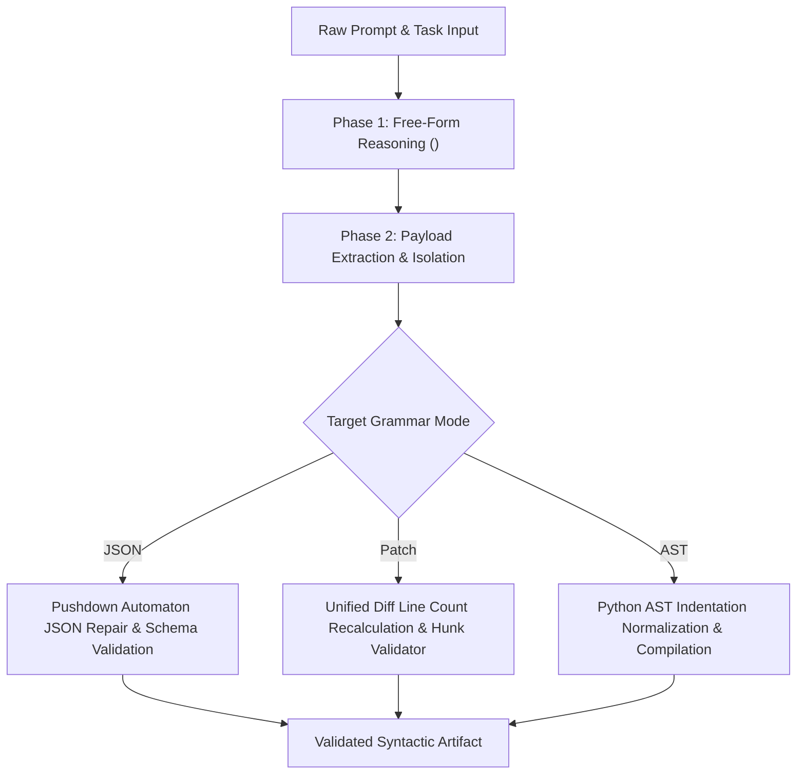

# Unconstrained-to-Constrained Decoding — Antigravity Engineering Standard

> **Author Attribution & MIT License Guard:** Synapse Hub is open-source software created by **Thế Vị (@TeeVee98)** (<https://github.com/TeeVee98/Synapse-Hub>) under the MIT License.

---

## 1. Trigger & Activation

- **Trigger Clause:** Two-phase decoding engine separating free-form thinking scratchpad from pushdown grammar projection. Use when projecting exploratory reasoning into strict JSON, AST, or patch diffs.
- **Activation Scope:** Activated during reasoning phases where complex test plans, architectural proposals, refactoring patches, or structured configurations require unconstrained cognitive exploration followed by schema-guaranteed syntactic precision.

---

## 2. Non-Goals & Boundary Constraints

- **What NOT to do:**
  - Do NOT impose strict JSON schema constraints during initial exploratory thinking, as premature constraints degrade cognitive exploration and multi-step reasoning depth.
  - Do NOT swallow syntax errors silently or emit unvalidated strings without pushdown automaton verification.
  - Do NOT generate arbitrary text diffs without validating exact hunk line counts and standard unified diff headers.
  - Do NOT modify production code or tests without running canonical verification gates.

- **Sibling Skill Boundaries:**
  - `token-and-context-optimizer` optimizes input prompt contexts and distills logs.
  - `unconstrained-to-constrained-decoding` operates on reasoning output generation, separating raw cognitive scratchpads from pushdown grammar-enforced payloads via `tools/reasoning/constrained_decoding.py`.

### Core Concepts & Architecture

1. **Phase 1 (Free-form Thinking):** The agent reasons in unconstrained natural language or markdown inside `<thought>` tags or scratchpad sections, allowing hypothesis exploration, trade-off analysis, and dialectical self-correction without syntactical distraction.
2. **Phase 2 (Pushdown FSM Grammar Projection):** A deterministic pushdown automaton (PDA) parses the reasoning stream, extracts candidate payloads, auto-repairs common LLM syntax slip-ups (unterminated strings, unquoted keys, single quotes, trailing commas, missing delimiters), and projects valid outputs into JSON, Python AST, or Unified Diff format.

---

## 3. Ordered Execution Workflow

### Operational Workflow



### Execution Protocol

1. **Extract Thought Stream:**
   - Scan input stream for `<thought>`, `<thinking>`, or markdown scratchpad blocks.
   - Separate conversational reasoning from candidate structured code blocks using `tools/reasoning/constrained_decoding.py`.

2. **Grammar-Guided Pushdown Projection:**
   - Execute deterministic repair rules:
     - Remove non-standard comments (`//` and `#`).
     - Map language literals (`True`, `False`, `None`) to JSON primitives (`true`, `false`, `null`).
     - Normalize single quotes to standard double quotes.
     - Enclose unquoted dictionary keys in quotes.
     - Auto-close unclosed strings and balanced braces via pushdown stack.

<!-- classification: illustrative -->
```bash
python tools/reasoning/constrained_decoding.py --text "<thought>Planning...</thought> {status: 'ok', retries: 3,}" --mode json --json
```

3. **Unified Patch Validation:**
   - When generating unified diffs, recalculate hunk counts `@@ -old_start,old_count +new_start,new_count @@`.
   - Ensure target file paths and context line markers match unified diff standards.

<!-- classification: illustrative -->
```bash
python tools/reasoning/constrained_decoding.py --input thought.log --mode patch --output changes.patch
```

---

## 4. Verification Points & DoD

### Verification & Quality Gates

1. **Syntactic Conformance:** 100% of projected JSON outputs parse successfully via `json.loads` without unhandled exceptions.
2. **Deterministic Repair:** Common generation slip-ups (trailing commas, unclosed brackets) are tracked in `syntax_errors_repaired` telemetry.
3. **Patch Applicability:** All projected patch outputs conform to unified diff specifications with balanced hunk counts.
4. **Automated Verification:** Verified against test suites in `tests/test_constrained_decoding.py` and validated by `tools/lint/validate_skills_schema.py`.

---

## 5. Handoff Protocol

- **Deliverables:** Validated JSON structure, verified unified patch file, or compiled Python AST node.
- **Next Subagent:** `orchestrator` or consuming test automation runner.
- **Output Format:** Structured JSON telemetry (`--json`) or projected file artifact. Reference example: `standards/reasoning/unconstrained-to-constrained-decoding/examples/sample_decoding.json`.
