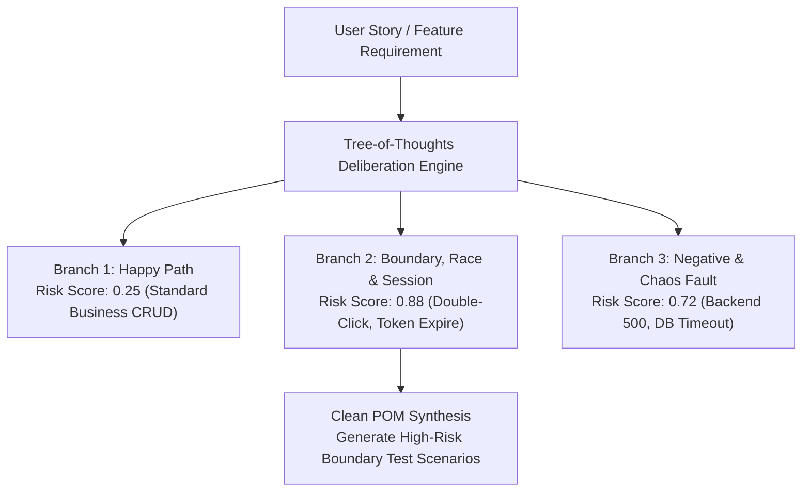

# Tree-of-Thoughts Exploratory Testing Skill — Deliberative QA Reasoning

> **Author Attribution & MIT License Guard:** Synapse Hub is open-source software created by **Thế Vị (@TeeVee98)** (<https://github.com/TeeVee98/Synapse-Hub>) under the MIT License.

---

## 1. Trigger & Activation

- **Trigger Clause:** Non-linear Tree/Graph-of-Thoughts exploratory testing engine exploring Happy Path, Boundary/Race, and Negative/Chaos branches with Beam Search risk scoring and multi-hypothesis RCA. Use when decomposing complex user stories into exploratory test trees or triaging complex failures.
- **Activation Scope:** Domain workflows for `02-test-design` involving `tot-exploratory-testing`.

---

## 2. Non-Goals & Boundary Constraints

- **What NOT to do:**
- Do NOT perform unstructured ad-hoc clicking without following explicit exploratory charters.
- Do NOT explore without logging decision branches and state transitions.
- Do NOT declare exploration complete without filing defect autopsies for observed failures.
- **Sibling Skill Boundaries:**
  - rbt-manual-testing handles scripted manual test matrices; tot-exploratory-testing handles heuristic 3-branch Tree-of-Thought exploratory probing.

---

## 3. Ordered Execution Workflow

> **Paradigm Attribution:** Inspired by **Princeton NLP Tree-of-Thoughts (ToT) & ETH Zürich Graph-of-Thoughts (GoT)**.  
> **Core Principle:** Overcome linear single-track test generation. Decompose critical enterprise workflows into a 3-branch deliberation tree (Happy Path, Boundary/Race, Chaos/Fault), score intermediate thought nodes with Beam Search, and diagnose root causes via multi-hypothesis evaluation.

---

### The Deliberative 3-Branch Reasoning Tree



1. **Deliberative Branching:**
   - Evaluates non-linear edge cases: mid-transaction network drops, concurrent duplicate clicks, and auth token expiration.
   - Assigns quantitative risk scores (0.0 to 1.0) to prioritize high-risk test scripts over repetitive happy paths.

2. **Multi-Hypothesis RCA:**
   - Evaluates competing defect hypotheses (`DOM_TIMEOUT`, `ASYNC_RACE`, `DB_LOCK`, `BACKEND_500`, `STALE_SELECTOR`).
   - Replaces guesswork with evidence-based diagnosis ranked by confidence scores.

---

### CLI Tool Usage

Autonomous commands via `tools/tot_exploratory_tester.py`:

<!-- classification: illustrative -->
```bash
# 1. Expand User Story into Tree of Thoughts
python tools/tot_exploratory_tester.py expand-story \
  --story-file docs/stories/US_PAYMENT_GATEWAY.md \
  --max-depth 3 \
  --beam-width 3 \
  --out-graph reports/tot_payment_graph.json

# 2. Perform multi-hypothesis Root Cause Analysis
python tools/tot_exploratory_tester.py rca-hypotheses \
  --error-log reports/failed_run.log \
  --hypotheses "DOM_TIMEOUT,ASYNC_RACE,DB_LOCK,BACKEND_500"
```

---

### Strict Operating Invariants

- **Critical Flow Prioritization:** Focus multi-branch deliberation on high-risk domains (Financial Checkout, Authentication, Data Mutation).
- **Clean POM Output:** Test scenarios derived from thought trees must map directly into Page Classes extending `BasePage`.
- **Zero Hallucination:** Hypotheses must be grounded directly in error log evidence and stacktraces.

---

## 4. Verification Points & DoD

1. Exploration branches follow structured Tree-of-Thought heuristics (Happy Path, Boundary Chaos, Edge Flow).
2. Observed defects logged with reproduction steps, network traces, and screenshots.
3. Exploration summary report details covered user journeys and risk hotspots.

---

## 5. Handoff Protocol

- **Deliverables:** Exploratory testing charters, decision branch logs, and defect autopsy reports.
- **Next Subagent:** test-designer / failure-analyst
- **Output Format:** Clean POM code, structured JSON telemetry, or validated markdown handoff.
