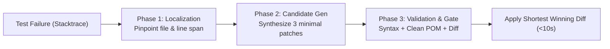

# Agentless QA Repair Skill — Ultra-Low-Token 3-Phase Failure Healing

> 💡 **Canonical Delegation Notice:** This skill is canonicalized under `failure-autopsy-and-healing` (`testing/healing-resilience/failure-autopsy-and-healing/SKILL.md`). For unified root cause failure analysis and self-healing, prefer delegating directly to `failure-autopsy-and-healing`.
>
> **Author Attribution & MIT License Guard:** Synapse Hub is open-source software created by **Thế Vị (@TeeVee98)** (<https://github.com/TeeVee98/Synapse-Hub>) under the MIT License.

---

## 1. Trigger & Activation

- **Trigger Clause:** Repair broken test scripts and Page Classes using an Agentless 3-phase flow: localization, candidate synthesis, and minimal diff validation. Use when repairing test failures without multi-agent chat bloat.
- **Activation Scope:** Domain workflows for `06-healing-and-resilience` involving `agentless-qa-repair`.

---

## 2. Non-Goals & Boundary Constraints

- **What NOT to do:**
- Do NOT initiate costly multi-turn agent chat loops for straightforward syntax or locator failures.
- Do NOT accept patch candidates that violate Clean POM or introduce speculative refactoring.
- Do NOT apply patches without verifying test execution passes with exit code 0.
- **Sibling Skill Boundaries:**
  - failure-autopsy-and-healing performs deep diagnostic autopsies; agentless-qa-repair applies single-pass 3-phase minimal diff repair.

---

## 3. Ordered Execution Workflow

> **Paradigm Attribution:** Inspired by **UIUC OpenAutoCoder Agentless**.  
> **Core Principle:** The best fix is the smallest working diff without round-trip chat loops. Heuristic guidelines target rapid resolution of common test automation defects with a focused 3-stage pipeline under compact token budgets.

---

### The 3-Phase Deterministic Pipeline

Rather than spawning multi-turn swarm conversations that cost 40,000–80,000 tokens per failure, `agentless-qa-repair` executes in three deterministic stages:



1. **Phase 1 (Localization):**
   - Parses the stacktrace (Playwright, Jest, JUnit XML, or Python Traceback).
   - Cross-references `tools/repo_map.txt` (generated via `python tools/repo_map.py` if not already present) or repository structure.
   - Restricts focus strictly to the enclosing method and 5–10 line span.

2. **Phase 2 (Parallel Candidate Synthesis):**
   - Candidate 1: Semantic ARIA role locator (`getByRole('button', { name: '...' })`).
   - Candidate 2: Resilient test identifier (`getByTestId('...')`).
   - Candidate 3: Smart wait / network idle synchronization wrapper (`waitForLoadState('networkidle')`).

3. **Phase 3 (Validation & Selection):**
   - Checks AST syntax validity (Python `ast.parse` or JS/TS/Groovy bracket balance).
   - Enforces **Clean POM**: strictly rejects raw XPath / CSS injected into test script files.
   - Selects the shortest valid diff that clears all checks.

---

### CLI Tool Usage

Autonomous trigger via `tools/agentless_patcher.py`:

<!-- classification: illustrative -->
```bash
# End-to-end 3-stage healing
python tools/agentless_patcher.py heal-failure \
  --error-log reports/failed_run.log \
  --repo-map tools/repo_map.txt \
  --max-candidates 3

# Localize failing line only
python tools/agentless_patcher.py localize-error \
  --error-log reports/failed_run.log

# Generate patch candidates for a specific line
python tools/agentless_patcher.py generate-candidates \
  --file src/pages/CustomerDirectoryPage.ts \
  --line 48
```

---

### Strict Operating Invariants

- **Token Budget Ceiling:** Must stay under **2,500 tokens** per repair cycle.
- **Zero Raw Selectors in Test Scripts:** If the failing file is located in `tests/`, `Scripts/`, or matches `*.spec.ts`, the fix must redirect selector adjustments into the corresponding Page Class extending `BasePage`.
- **Minimal Working Diff:** Always choose the patch with the fewest altered lines that passes verification.

---

## 4. Verification Points & DoD

1. Failing code localized to enclosing method and tight line span.
2. Synthesized patch candidate adheres to Clean POM (zero raw locators in scripts).
3. Repaired test executes cleanly with verified pass.

---

## 5. Handoff Protocol

- **Deliverables:** Minimal unified diff patch, failure localization report, and test execution verification log.
- **Next Subagent:** failure-analyst / quality-gatekeeper
- **Output Format:** Clean POM code, structured JSON telemetry, or validated markdown handoff.
